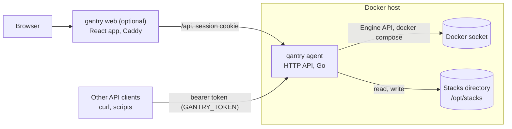

# gantry

Lightweight Docker Compose manager: a small headless **agent** that runs on a
Docker host and exposes an HTTP API for managing Compose stacks, plus an
optional **web UI** that runs as its own container.

> Early stage. The agent lists stacks, shows their details and logs, starts,
> stops, restarts, updates and removes them, and edits, creates and deletes
> managed stacks; the web UI does all of that in the browser, in English and
> German.

## Architecture



- **Agent:** a single Go binary per Docker host. Recommended as a **systemd
  service**; also available as a **container image**.
- **API-first:** everything the agent does is available via its versioned
  HTTP API (`/api/v1/`), described by [`api/openapi.yaml`](api/openapi.yaml).
- **Web UI (optional):** a static React app in its own container (Caddy) that
  only talks to the agent's API.
- **Platforms:** linux/amd64 and linux/arm64.
- **Standalone:** gantry works on its own; it needs no other service.

Reasons for these choices: [docs/decisions.md](docs/decisions.md).

## Stacks

A stack is a Compose project.

- **Managed stacks** live in `GANTRY_STACKS_DIR` (default `/opt/stacks`), one directory per stack
  with a `compose.yaml` (or `compose.yml`, `docker-compose.yaml`,
  `docker-compose.yml`). The directory name is the project name and must be a
  valid Compose project name: lowercase letters, digits, `-` and `_`.
- **Unmanaged stacks** are other Compose projects running on the host,
  found through the labels Compose sets on their containers. gantry shows
  them read-only with `managed: false`.

```
/opt/stacks/
  whoami/compose.yaml
  nextcloud/compose.yaml
  nextcloud/.env
```

A stack's status is `running` (every service has a running container),
`partial`, `stopped` or `unknown` (Docker unreachable).

## Web UI

The web UI lists all stacks with their status and runs actions with live
output; a stack's page shows services, containers and recent operations.
Changes appear right away, also those made outside gantry (e.g. `docker
stop` in a shell): the UI follows the agent's live event stream and reloads
what changed.

- **Logs:** the logs of all containers merged and live, with colors, a
  service filter, search, timestamps and a download; each container's logs
  button opens it already filtered.
- **Compose:** an editor with YAML highlighting and search. Saving checks the
  file with Compose first; *Save & apply* also starts the stack. If the file
  was changed elsewhere in the meantime, you're asked to reload instead of
  overwriting it.
- **Environment:** the stack's `.env` variables by name. A value is loaded
  only when you click to show or edit it.
- **Services:** each service on the Overview tab has a menu to start, stop,
  restart or update just that service. If that changes other services too
  (see [Service actions](#service-actions)), they are listed for you to
  confirm first.
- **New stack** on the list page, **Delete stack** in a stack's menu (type
  the name to confirm; named volumes only if you tick the box).

Unmanaged stacks are read-only. The UI is in English and German (from the
browser's language, switchable) and has a light and a dark mode (following
the system by default, switchable in the app bar).

**Login:** enter the web login token (`GANTRY_UI_TOKEN`) once; the API token
doesn't work here. The agent exchanges it for a session cookie that
JavaScript can't read (`HttpOnly`, `SameSite=Strict`, 12 hours); the token
itself is never stored in the browser. Logging out ends the
session at once; restarting the agent ends all sessions, so you log in again
after an update. After 10 wrong tokens
within a minute, by login or `Authorization` header, a client has to wait
(`429` with `Retry-After`). Behind the web UI's proxy all browsers share one
such limit, unless the proxy is listed in `GANTRY_TRUSTED_PROXIES`; then each
browser has its own.

## API

Routes under `/api/` require authentication: `Authorization: Bearer
<GANTRY_TOKEN>` for API clients, or the session cookie for the web UI (from a
login with `GANTRY_UI_TOKEN`). Each token works only in its own place. With
the cookie, changing requests (POST, PUT, PATCH, DELETE) must come from the
same origin (`Origin` header), which protects against cross-site request
forgery. The agent logs every changing request with how it was
authenticated (`via=token` or `via=session`), never with its body.

| Route | Description |
|---|---|
| `GET /healthz` | Liveness check, public. 200 while the agent runs, even if Docker is down |
| `POST /api/v1/session` | Log in with `{"token": …}` (`GANTRY_UI_TOKEN`); sets the session cookie (public) |
| `GET /api/v1/session` | Whether and how the request is authenticated |
| `DELETE /api/v1/session` | Log out; clears the cookie (public) |
| `GET /api/v1/version` | Agent version |
| `GET /api/v1/stacks` | All stacks with status; `dockerAvailable` and `warnings` |
| `POST /api/v1/stacks` | Create a managed stack from `{name, compose, env?}` |
| `GET /api/v1/stacks/{name}` | Services, containers (state, health, ports), named volumes and the raw Compose file with its `version` |
| `DELETE /api/v1/stacks/{name}?confirm={name}` | Delete a stack permanently, as an operation; `volumes=true` also removes its named volumes |
| `PUT /api/v1/stacks/{name}/compose` | Replace the Compose file (`{content, version}`), validated first |
| `GET /api/v1/stacks/{name}/env` | Names of the `.env` variables (no values) and the file's `version` |
| `PATCH /api/v1/stacks/{name}/env` | Set and delete `.env` variables (`{version, set, delete}`) |
| `POST /api/v1/stacks/{name}/env/reveal` | One `.env` value (`{key}`), logged without the value |
| `GET /api/v1/stacks/{name}/logs` | Logs of all containers, merged and live, as Server-Sent Events |
| `GET /api/v1/events` | Which stacks changed, live, as Server-Sent Events (`ready`, `changed`) |
| `POST /api/v1/stacks/{name}/actions/{action}` | Run `start`, `stop`, `restart`, `update` or `down` as an operation |
| `POST /api/v1/stacks/{name}/services/{service}/actions/{action}` | Run `start`, `stop`, `restart` or `update` on one service and what depends on it (`{confirm?}`) |
| `GET /api/v1/operations` | Recent operations (`?stack=` to filter) |
| `GET /api/v1/operations/{id}` | Operation status and output |
| `GET /api/v1/operations/{id}/events` | Live output as Server-Sent Events |
| `POST /api/v1/operations/{id}/cancel` | Cancel a running operation |

The full contract is [`api/openapi.yaml`](api/openapi.yaml). Stack details
return the Compose file as stored: variables like `${DB_PASSWORD}` stay
unresolved. `.env` values are only returned one at a time by the reveal
endpoint. Errors carry a machine-readable `code` (e.g. `stack_busy`,
`stack_unmanaged`, `invalid_compose`, `version_conflict`). All `/api/`
responses are sent with `Cache-Control: no-store`. Request bodies are limited
to 4 MiB (4 KiB for the login); larger ones are refused with `413
request_too_large`. Requests must arrive within a minute; responses such as
event streams may run as long as needed.

### Live changes

`GET /api/v1/events` tells clients when to reload, instead of polling. It
only names the stacks that changed; read them with the usual endpoints.

```bash
curl -N -H "Authorization: Bearer $GANTRY_TOKEN" http://127.0.0.1:7070/api/v1/events
# event: ready
# data: {}
#
# event: changed
# data: {"stacks":["whoami"],"all":false}
```

`ready` comes on every connect: reload everything, changes may have been
missed. `changed` with `"all": true` means the same (e.g. Docker was
unreachable). Changes from Docker's container events and from gantry's own
operations and file saves are collected for a quarter second; an idle stream
gets a `ping` event every 25 seconds.

### Logs

`GET /api/v1/stacks/{name}/logs` works like `docker compose logs -f`: first
the last `tail` lines (default 200, at most 5000) of every container, merged
by time, then new lines as they appear. Containers that are started or
recreated meanwhile (e.g. by `restart` or `update`) are picked up without
repeating lines. `service` and `container` filter; `follow=false` ends after
the past lines with an `end` event. Unmanaged stacks can be read too.

```bash
curl -N -H "Authorization: Bearer $GANTRY_TOKEN" "http://127.0.0.1:7070/api/v1/stacks/whoami/logs?tail=20"
# event: log
# data: {"time":"2026-11-12T20:15:03.112Z","service":"whoami","container":"whoami-whoami-1","stream":"stdout","line":"Starting up on port 80"}
```

Lines come as the programs wrote them, including ANSI color codes (the web UI
renders them), and may contain anything the programs print. If Docker can't
be read, a `failed` event ends the stream.

### Editing stacks

Only managed stacks can be edited. Every write is checked and atomic: a new
Compose file is validated with `docker compose config` before it replaces
the old one (`400 invalid_compose` with Compose's message otherwise), and
files are written to a temporary file and renamed, so a crash never leaves
half a file.

**Versions** prevent lost updates. Reads return a `version` (the SHA-256 of
the content); send it back when saving. If the file has changed since, e.g.
over SSH or in another browser tab, the agent answers `409
version_conflict` instead of overwriting it.

```bash
curl -H "Authorization: Bearer $GANTRY_TOKEN" http://127.0.0.1:7070/api/v1/stacks/whoami | jq -r .composeFile.version
# 3b1f…
curl -X PUT -H "Authorization: Bearer $GANTRY_TOKEN" -H "Content-Type: application/json" \
  -d '{"version":"3b1f…","content":"services:\n  whoami:\n    image: traefik/whoami:v1.12\n"}' \
  http://127.0.0.1:7070/api/v1/stacks/whoami/compose
```

Saving doesn't touch running containers; run `start` to apply the changes.

**`.env`:** `GET …/env` lists only the names. `PATCH …/env` sets and
deletes variables, keeping comments, blank lines and order; values are
quoted as needed. A single value is returned by `POST …/env/reveal`, which
the agent logs (stack, key and client, never the value). New `.env` files
are created with mode `0600`.

**Creating** a stack writes `compose.yaml` (and `.env`, if given) into a new
directory in `GANTRY_STACKS_DIR`, after validating them. Names already used
by a directory or a running Compose project are refused with `409
stack_exists`.

**Deleting** a stack (`DELETE /api/v1/stacks/{name}?confirm={name}`) runs as
an operation: `down --remove-orphans`, then the stack's directory is
removed, **including data in it such as `./data`**. This can't be undone.
Named volumes are kept unless `volumes=true` is passed. `confirm` must repeat
the stack name.

Symlinked stack directories and files are never edited or deleted; files are
limited to 1 MiB.

### Actions

Only managed stacks can be changed; unmanaged ones answer `409
stack_unmanaged`.

| Action | Compose | Effect |
|---|---|---|
| `start` | `up -d --remove-orphans` | Creates or updates containers to match the Compose file |
| `stop` | `stop` | Stops containers; they are kept |
| `restart` | `stop`, then `start` | Restarts existing containers, **without** applying Compose file changes (use `start` for that) |
| `update` | `pull --ignore-buildable`, then `up -d --remove-orphans` | Pulls new images and recreates changed containers |
| `down` | `down --remove-orphans` | Removes containers and networks. **Volumes are never removed** (only deleting a stack with `volumes=true` does) |

### Service actions

`POST /api/v1/stacks/{name}/services/{service}/actions/{action}` runs
`start`, `stop`, `restart` or `update` on one service. gantry follows the
service's dependencies (`depends_on`, `network_mode: service:…`,
`volumes_from`) in both directions, so nothing is left broken:

| Action | Also affected |
|---|---|
| `start` | Stopped services it needs are started first |
| `stop` | Running services that need it are stopped too |
| `restart` | Running services that need it are restarted too; stopped services it needs are started |
| `update` | Pulls its image and recreates it; stopped services it needs are started; running services that need it are restarted |

gantry hands Compose exactly these services, with `--no-deps`, so what you
confirmed is what happens. If more than the chosen service is affected, the
agent answers `409 confirmation_required` with the plan; send the request
again with `confirm` listing exactly those services:

```bash
curl -X POST -H "Authorization: Bearer $GANTRY_TOKEN" http://127.0.0.1:7070/api/v1/stacks/shop/services/db/actions/restart
# 409 {"code":"confirmation_required","plan":{"service":"db","action":"restart","affected":[
#   {"service":"db","effect":"restart","reason":"target"},
#   {"service":"app","effect":"restart","reason":"dependent"}]},...}

curl -X POST -H "Authorization: Bearer $GANTRY_TOKEN" -H "Content-Type: application/json" \
  -d '{"confirm":["db","app"]}' http://127.0.0.1:7070/api/v1/stacks/shop/services/db/actions/restart
# 202 {"id":"op_…","action":"restart","service":"db","services":["db","app"],...}
```

The plan is worked out again when the action starts; if the services' state
changed in between, you get a new `confirmation_required`. Service actions
run as operations like stack actions, but never cancel a running one: while
an operation runs on the stack, they are rejected with `stack_busy`.

### Operations

Actions can take minutes (image pulls), so they run as operations: the
request returns `202` with the operation at once, and you follow it.

```bash
curl -X POST -H "Authorization: Bearer $GANTRY_TOKEN" http://127.0.0.1:7070/api/v1/stacks/whoami/actions/update
# {"id":"op_3f9c2a71b0de","stack":"whoami","action":"update","status":"running",...}

curl -N -H "Authorization: Bearer $GANTRY_TOKEN" http://127.0.0.1:7070/api/v1/operations/op_3f9c2a71b0de/events
# event: output
# data: $ docker compose pull --ignore-buildable
# ...
# event: done
# data: {"id":"op_3f9c2a71b0de","status":"succeeded","exitCode":0,...}
```

- **One operation per stack.** `start`, `restart` and `update` are rejected
  with `409 stack_busy` (naming the running operation) while another
  operation runs. **`stop` and `down` take precedence**: they cancel the
  running operation and then run, as an emergency brake. They run their
  command twice in that case, to settle Docker calls the canceled operation
  had already made. Other stacks are not affected.
- **Cancel** sends Compose an interrupt, like Ctrl+C. The stack may be left
  partly changed; the next `start` or `stop` brings it back to a consistent
  state.
- Each operation is limited to **30 minutes**. Output is kept up to 1 MiB
  (the end).
- Operations are kept **in memory** for an hour; they are gone after an agent
  restart. The stacks themselves are unaffected, since their state comes from
  Docker.
- Browsers' `EventSource` can't send an `Authorization` header; read the event
  stream with `fetch`.

## Configuration

| Variable | Default | Description |
|---|---|---|
| `GANTRY_TOKEN` | (none) | API token, only as `Authorization: Bearer` (scripts, curl). Generate it: `openssl rand -hex 24`. The agent refuses tokens shorter than 24 characters, with fewer than 8 different characters, or made of one repeated piece. Without it, bearer access is off; at least one of `GANTRY_TOKEN` and `GANTRY_UI_TOKEN` is required |
| `GANTRY_TOKEN_FILE` | (none) | Instead of `GANTRY_TOKEN`: a file holding the token, e.g. a systemd credential (`LoadCredential=`) or a Docker secret, so it isn't in the process environment |
| `GANTRY_UI_TOKEN` | (none) | Token for the web UI login, only there. Same rules as `GANTRY_TOKEN`, and different from it. Without it, the web login is off |
| `GANTRY_UI_TOKEN_FILE` | (none) | Instead of `GANTRY_UI_TOKEN`: a file holding it |
| `GANTRY_STACKS_DIR` | `/opt/stacks` | Directory with the managed stacks (same default as Dockge) |
| `GANTRY_LISTEN` | `127.0.0.1:7070` (image: `:7070`) | Listen address. The binary only accepts local connections by default; set e.g. `:7070` to reach it from other hosts |
| `GANTRY_TRUSTED_PROXIES` | (none) | Reverse proxies (IP addresses or CIDR prefixes, comma-separated) whose `X-Forwarded-For` and `X-Forwarded-Proto` the agent believes, such as the web UI's container. Then every client behind them has its own login limit |
| `GANTRY_ALLOW_INSECURE_HTTP` | `false` | Accept tokens and session cookies over plain HTTP from internet addresses. Only if you know why: anyone on the way can read them. Also understood by the web UI's container |
| `GANTRY_PUBLIC_URL` | (none) | Address of the web UI, e.g. `https://gantry.example.com`. If set, cookie-authenticated requests must come from exactly this origin, and with `https` the session cookie is `Secure` and named `__Host-gantry_session` |
| `DOCKER_HOST` | `unix:///var/run/docker.sock` | Docker socket (only `unix://` is supported) |

**Two tokens:** if one leaks or lands in the wrong place, replace just that
one: set a new value and restart the agent. Restarting ends all sessions,
including any opened with the old token; whatever uses the other token keeps
working.

The stacks directory uses the same default and layout as Dockge, so gantry
picks up existing Dockge stacks without configuration. If the directory
doesn't exist, the agent still starts, lists unmanaged stacks and reports the
missing directory as a warning.

The agent needs `docker compose` (the Compose plugin of Docker's official
packages) on the host. The container image includes it.

**Write access:** to create, edit and delete stacks, the user the agent runs
as needs write access to `GANTRY_STACKS_DIR` and the stacks in it. For a
systemd service that runs as a dedicated user, give that user ownership of
the directory (e.g. `chown -R gantry: /opt/stacks`); otherwise stacks can
only be listed and controlled. The container image runs as root.

**Private registries:** Compose uses the Docker credentials of the user the
agent runs as (`~/.docker/config.json`, from `docker login`). In container
mode, mount that file into the container (e.g.
`/root/.docker/config.json:/root/.docker/config.json:ro`).

### Running as a container

Mount the Docker socket and the stacks directory **at the same path** inside
the container as on the host. Docker resolves relative bind mounts of stacks
(e.g. `./data`) on the host, using the path the agent passes:

```yaml
services:
  gantry-agent:
    image: ghcr.io/pixl-media/gantry-agent:edge
    environment:
      GANTRY_TOKEN: ${GANTRY_TOKEN}
      GANTRY_UI_TOKEN: ${GANTRY_UI_TOKEN}
      GANTRY_STACKS_DIR: /opt/stacks
      # The web UI below is a trusted proxy: every browser gets its own
      # login limit.
      GANTRY_TRUSTED_PROXIES: 172.30.250.0/24
      # The web UI's address, see "Exposing gantry" below.
      # GANTRY_PUBLIC_URL: https://gantry.example.com
    # No published port: the web UI reaches the agent over the network
    # below. For API clients on other hosts, publish it deliberately, e.g.
    # "127.0.0.1:7070:7070" for this host only.
    volumes:
      - /var/run/docker.sock:/var/run/docker.sock
      - /opt/stacks:/opt/stacks
    logging:
      options:
        max-size: 10m
    restart: unless-stopped

  # Optional web UI. It forwards /api to the agent.
  gantry-web:
    image: ghcr.io/pixl-media/gantry-web:edge
    environment:
      GANTRY_AGENT_URL: http://gantry-agent:7070
    ports:
      # This host only. Docker's published ports bypass host firewalls
      # (ufw, firewalld), so open it to others deliberately, behind HTTPS.
      - "127.0.0.1:8080:8080"
    logging:
      options:
        max-size: 10m
    restart: unless-stopped

networks:
  default:
    ipam:
      config:
        # Fixed, so GANTRY_TRUSTED_PROXIES can name it; pick another range
        # if it collides with one of your networks.
        - subnet: 172.30.250.0/24
```

The web UI speaks plain HTTP on port 8080. The web container also works with
an agent running as a systemd service: point `GANTRY_AGENT_URL` at it, and
set the agent's `GANTRY_LISTEN` so the container can reach it.

**Exposing gantry.** The agent controls Docker, which is root on the host.
gantry is built to stay safe even when exposed carelessly, but for access
beyond your own machine:

- **HTTPS is required from the internet.** Tokens and session cookies sent
  over plain HTTP from an internet address are refused (`403
  https_required`), by the agent and by the web UI's container; private
  networks, VPN address space (100.64.0.0/10) and this host are fine. Put
  gantry behind a reverse proxy with HTTPS (e.g. Caddy, Traefik). Proxies in
  private networks are trusted for `X-Forwarded-Proto`, so the session cookie
  is then marked `Secure`.
- Publish ports deliberately: the agent's not at all if only the web UI
  uses it, the web UI's on `127.0.0.1` or behind your proxy. Published
  Docker ports bypass host firewalls.
- Use random tokens (`openssl rand -hex 24`, one for each); the agent
  refuses obviously weak ones and the same token twice. Logins and bearer tokens are limited to 10 wrong attempts per
  minute per client (per /64 for IPv6).
- Give it **its own hostname**, such as `gantry.example.com`. Browsers send
  cookies to every port of a host, so with the UI at `http://nas:8080`, the
  session cookie also reaches every other web app on `http://nas:<port>`,
  including the containers gantry manages, and any of them could use it.
- Set `GANTRY_PUBLIC_URL` on the agent to that address. Changing requests from
  the browser must then come from exactly this origin, and with HTTPS the
  cookie is always `Secure` and can't be set by other hosts (`__Host-`).

## Layout

| Path | What |
|---|---|
| `agent/` | Go agent: its own Go module and Dockerfile |
| `api/openapi.yaml` | API contract; Go code is generated from it |
| `web/` | Optional web UI: React, Vite, MUI; Dockerfile and Caddyfile |
| `dev/stacks/` | Example stacks for local development |
| `docs/` | Architecture decisions |
| `compose.yaml` | Local development with agent and web UI as containers |
| `api.http` | Example requests for the VS Code REST Client |
| `agent/tools/devdocs/` | Dev-only Swagger UI server (`make docs`) |
| `.github/workflows/ci.yml` | Tests, image builds and releases |
| `AGENTS.md`, `agent/AGENTS.md`, `web/AGENTS.md` | Conventions for contributors and coding agents |
| `LICENSE` | GNU AGPLv3 |

## Development

Requirements: Go 1.27+, Docker with the Compose plugin; for the web UI
Node 24 or newer (CI and the image use Node 26 LTS) and pnpm 10.

```bash
make run               # agent on http://127.0.0.1:7070, tokens from .env, managing dev/stacks
make web-install       # once: install the web UI's dependencies
make web               # web UI on http://127.0.0.1:5173 (in a second terminal), log in with GANTRY_UI_TOKEN from .env
make docs              # Swagger UI on http://127.0.0.1:8082 (in a second terminal)
make test              # unit tests, no Docker needed
make test-integration  # unit + integration tests against the local Docker daemon
make lint              # gofmt + go vet
make generate          # regenerate Go code after changing api/openapi.yaml
make image             # build the agent's Docker image locally
make web-test          # web UI tests (Vitest)
make web-lint          # ESLint, Prettier, typecheck
make web-generate      # regenerate the web UI's API types after changing the spec
make web-image         # build the web UI's Docker image locally
```

The web dev server forwards `/api` to the agent (`GANTRY_AGENT_URL`, default
`http://127.0.0.1:7070`), so the app and the API share one origin, as behind
Caddy in the container.

Try it: start an example stack with `docker compose up -d` in
`dev/stacks/whoami`, run `make run`, and send the requests in
[`api.http`](api.http) (VS Code extension "REST Client"), or:

```bash
export GANTRY_TOKEN=$(sed -n 's/^GANTRY_TOKEN=//p' .env)
curl -H "Authorization: Bearer $GANTRY_TOKEN" http://127.0.0.1:7070/api/v1/stacks
```

`make run` takes both tokens from `.env` (git-ignored) and creates that file
with random tokens on first use, or adds a missing one (`make dev-env`), so
the dev agent never runs with a token anyone could guess. The agent refuses
tokens shorter than 24 characters.

Agent and web UI in containers: `make dev-env && docker compose up --build`
(run from the repo root), then open http://127.0.0.1:8080 and log in with
`GANTRY_UI_TOKEN` from `.env`.

Integration tests create their own stacks named `gantry-test-…` and remove
them afterwards; other containers on the host are not touched.

### API docs

`make docs` serves Swagger UI for `api/openapi.yaml` on
http://127.0.0.1:8082 and forwards API requests to the agent on port 7070
(`make run` or `docker compose up`). Everything comes from one address, so
"Try it out" works without CORS: click "Authorize", enter the token (from
`.env` for `make run`), and send requests. The spec is re-read on every page load.
This is a development tool only; the agent doesn't serve docs itself.

### Changing the API

1. Edit `api/openapi.yaml`.
2. `make generate` updates `agent/internal/api/api.gen.go` (never edit it by
   hand).
3. Implement the new methods in `agent/internal/api/handlers.go`; the
   compiler shows what's missing.
4. `make web-generate` updates the web UI's types
   (`web/src/api/schema.gen.ts`).

## Known limitations

- One-shot services (e.g. init containers that exit with code 0) make a stack
  show as `partial`.
- For unmanaged stacks, only services that currently have containers are
  known.
- Operations are kept in memory only and are lost when the agent restarts.
- Swagger UI (`make docs`) can't display the event stream; use `curl -N`.
- One shared web login (`GANTRY_UI_TOKEN`); there are no user accounts
  (decision 25).
- Files edited directly on the host (not through gantry) show up in the web
  UI within a minute; Docker reports no event for them.
- Stacks can't be renamed (named volumes carry the project name).
- There is no history or undo for Compose files; validation and version
  checks protect against mistakes and lost updates.
- Validation checks the structure of a Compose file, not whether images
  exist or variables are set.
- Logs exist only as long as Docker keeps them; with log drivers such as
  `none` or `syslog` Docker returns none.

## Non-goals

gantry stays a lightweight manager for one host: no database or files of its
own, only what Docker and Compose can do, no background calls to outside
services. Several hosts in one UI, user accounts and roles, resource
history, a history of Compose files, a console in containers and "update
available" hints are out of scope (`docs/decisions.md`, decision 25).
- The web UI keeps at most 10,000 log lines and searches only those, in the
  browser.

## Workflow and releases

GitHub Flow: `main` is always releasable. Work happens on short-lived branches
(`feature/…`, `fix/…`, `chore/…`) that are merged into `main` via pull request.

| Event | CI |
|---|---|
| Pull request | Go and web tests, integration tests, both images built and smoke-tested, not pushed |
| Merge to `main` | same, then `ghcr.io/pixl-media/gantry-agent:edge` and `gantry-web:edge` are pushed |
| Tag `vX.Y.Z` | same, then `:X.Y.Z`, `:X.Y`, `:latest` of both images are pushed |

Release: test `:edge`, then `git tag v0.1.0 && git push origin v0.1.0`.

Planned: release binaries and `.deb`/`.rpm` packages with a systemd unit
for amd64 and arm64.

## License

gantry is licensed under the [GNU Affero General Public License v3.0](LICENSE)
(`AGPL-3.0-only`). You may use, modify and share it, also commercially.
If you distribute a modified version, or let others use a modified version
over a network, you have to offer its source code under the same license.

Issues and ideas are welcome. Code contributions are not accepted for now.
